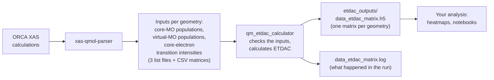

# atomistic_oscillator_strength

Calculates the **electron transition density atomic contribution (ETDAC) matrix** from X-ray absorption spectroscopy (XAS) calculations. The ETDAC matrix _splits_ the core-electron transition intensities (from core to virtual molecular orbitals) into contributions from pairs of atoms: the atom the core electron leaves (core atom) and the atom where it arrives (virtual atom). With it, excited-state charge transfer between molecular fragments can be quantified, for example in π-stacked aromatic amino acids.

The method and its applications are described in:

> *X-ray absorption spectroscopy reveals charge transfer in π-stacked aromatic amino acids*, Phys. Chem. Chem. Phys. (2025). https://doi.org/10.1039/D4CP04615C

The ETDAC matrix element is written in the paper as [$$\tilde{\gamma}^{[l,m]}_{AA^{\prime}}$$](https://pubs.rsc.org/en/content/articlelanding/2025/cp/d4cp04615c). It is built from three inputs per molecular geometry: the Löwdin populations of the core molecular orbitals (MOs) on each atom, the Löwdin populations of the virtual MOs on each atom, and the core-electron transition intensities from each core MO to each virtual MO.

## How it works



The inputs come from [xas-qmol-parser](https://github.com/caraortizmah/x-ray_scripting_out), which parses ORCA outputs. Their format is described in [docs/input-format.md](docs/input-format.md). An earlier result is never overwritten: it is kept as `data_etdac_matrix_oldversionN.h5`.

## Install

Python 3.11 or newer. Not on PyPI yet; install from the repository:

```bash
git clone https://github.com/caraortizmah/atomistic_oscillator_strength.git
cd atomistic_oscillator_strength
python3 -m venv .venv && source .venv/bin/activate
pip install .
```

More options in [docs/installation.md](docs/installation.md).

## Run

The `qm-etdac` command is being completed for release 1.2.0 ([docs/examplesrun.md](docs/examplesrun.md)). Until then, run the calculation from Python, here on the Phe–Tyr example data shipped with the tests:

```python
from qm_etdac_calculator import Controler, Operations, default_data_root
from qm_etdac_calculator.outputs import prepare_outputs, write_etdac_h5

logs = "tests/data/phe_tyr"  # the folder with the three list files
reader = Controler(default_data_root(logs))
core = reader.load_dict_data(f"{logs}/resA_MOcore_list.log", "num-1")
virt = reader.load_dict_data(f"{logs}/resB_MOvirt_list.log", "num-1")
osc = reader.load_dict_data(f"{logs}/corevirt_fosce_AB_list.log", "virt\\core")

etdac = Operations().etdac_batch(core, virt, osc)  # {sample hash: core-atom x virtual-atom matrix}
paths = prepare_outputs("etdac_outputs")
write_etdac_h5(etdac, paths.h5, reader.inputs_read)
```

Each sample in the `.h5` file is a group `sample_<hash>` with the dataset `ETDAC_matrix`. The file also records which program version made it and which input files were used.

## Notebooks

The original analysis notebooks are kept in the repository:

- `popmatrices/`: ETDAC calculation and post-analysis. The reference calculation is [popmatrices/Bigscale/ETDAC_matrix_calculator.ipynb](popmatrices/Bigscale/ETDAC_matrix_calculator.ipynb); the general post-analysis template is [popmatrices/Standard_analysis/postanalysis_generalcase.ipynb](popmatrices/Standard_analysis/postanalysis_generalcase.ipynb). Examples: Phe–Tyr with the first 17 (`FY_1-17`) and 26 (`newFY_1-26`) excited states.
- `plot/`: XAS spectra plotted directly from the ORCA outputs.

## For developers

How the program is built, tested, logged, debugged and hardened: [docs/development.md](docs/development.md). Design decisions: [docs/adr/](docs/adr/). Status and plans: [docs/project-state.md](docs/project-state.md). Changes: [CHANGELOG.md](CHANGELOG.md).

## License

This program is free software: you can redistribute it and/or modify it under the terms of the GNU General Public License as published by the Free Software Foundation, either version 3 of the License, or (at your option) any later version. See [LICENSE](LICENSE).
