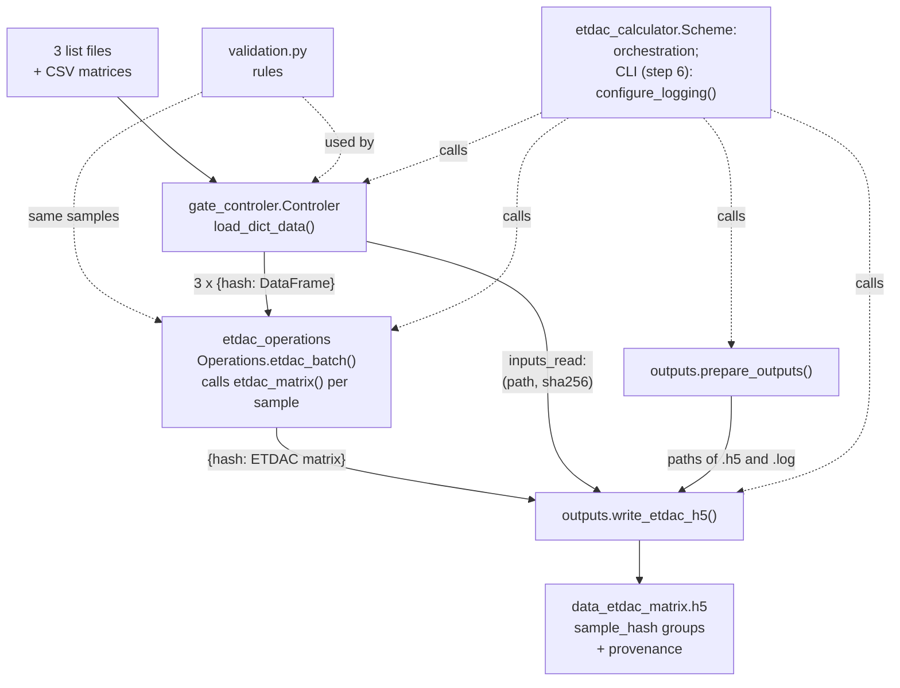
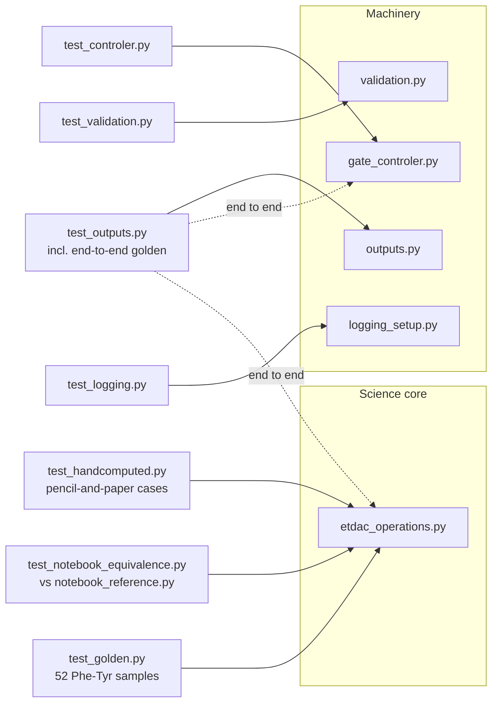
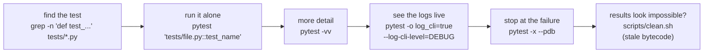
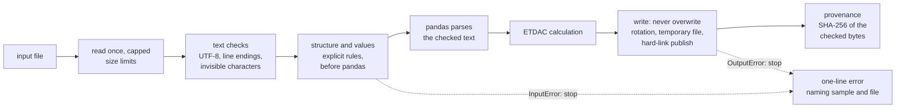

# Developer guide for qm_etdac_calculator

The program calculates the ETDAC matrix described in the [README](../README.md); that calculation is its purpose. This guide is for developers: how the program is built around the calculation, how it is tested, logged and debugged, how it is hardened, and where it is meant to grow. Read it in order: the science core first, then the machinery that serves it.

## 1. Architecture

### Module map (reading order)

| Module | Role | Receives | Gives back |
|--------|------|----------|------------|
| `etdac_operations.py` | **science core**: the ETDAC calculation. `etdac_matrix` (one sample), `Operations.etdac_batch` (all samples) | three `{hash: DataFrame}` dicts: core-MO populations, virtual-MO populations, core-electron transition intensities | `{hash: ETDAC matrix}` (core atom × virtual atom) |
| `etdac_calculator.py` | one run from start to end: `Scheme(config).prepare_outputs()`, then `run(paths)` | `ConfigMan` (and optionally `Operations`) | the results, written to `paths.h5` with provenance; also returned as `{hash: ETDAC matrix}` |
| `gate_controler.py` | reading the inputs: `Controler(data_root).load_dict_data(list_file, index_col)` | a list file and the CSV files it names | `{hash: DataFrame}`; `Controler.inputs_read` (path and SHA-256 of every file used) |
| `validation.py` | the input rules: used while reading (hashes, CSV structure and values, population sums) and by `etdac_batch` (the same samples in all three inputs) | raw lines and cells; the three sets of hashes | nothing, or an `InputError` / a warning |
| `outputs.py` | writing the results: `prepare_outputs`, `write_etdac_h5` | the results and `inputs_read` | `etdac_outputs/data_etdac_matrix.h5` |
| `config.py` | the run settings: `ConfigMan` (the three list files and the logs folder, i.e. the project folder); checks nothing itself | the documented keys (`corepop`, `virtpop`, `etranscv`, `logspath`) | `list_files()`: the paths of the three list files; `output_dir()`: `etdac_outputs/` inside the logs folder, the only place a run writes (ADR 0007) |
| `cli.py` | the `qm-etdac` command: `main(argv)` parses the arguments, configures logging (console, then the run log next to the results) and runs `Scheme`; `InputError`/`OutputError` become one `ERROR:` line and exit code 1 | the command line | exit code; results and run log in `LOGS/etdac_outputs/` |
| `logging_setup.py` | log configuration for the program entry point; `untrusted()` for values in messages | verbosity, log file path | configured loggers |
| `errors.py` | `InputError` (bad input files), `OutputError` (unusable output location) | | |

Terms: the third input is called **oscillator strengths** in the code, in the CSV files (`corevirt_fosce`, f = oscillator strength) and in ORCA. The user documentation and the program's messages to users call it **core-electron transition intensities**.

Not working yet (notebook leftovers, rebuilt in the next steps): the `auto` and `check` modes of `qm-etdac` and the `qm-etdac-test` command (steps 6.4 to 6.6), `etdac_editprinter.py` (heatmap selection helpers, step 6b) and the scripts in `bin/`.

### What each part receives and gives back



Errors travel up as `InputError` or `OutputError` and are printed by the CLI as one line; anything else is a program bug and keeps its traceback.

### Design rules

- Classes where there is state to protect (`Controler`: the data root and the files read; `Operations`: calculation options), functions where there is none.
- Libraries emit, applications configure: modules only log; only the entry point configures logging.
- The calculation never reads or writes files, and the reading and writing never calculate. A new input format or output format changes one module, not the science core.

## 2. Development setup

```bash
git clone https://github.com/caraortizmah/atomistic_oscillator_strength.git
cd atomistic_oscillator_strength
scripts/dev-setup.sh          # creates .venv and installs the locked dependencies + the package (editable)
source .venv/bin/activate
pytest                        # all tests green
```

What `scripts/dev-setup.sh` does, step by step:

```bash
python3 -m venv .venv
source .venv/bin/activate  # On Windows: .venv\Scripts\activate
python3 -m pip install --upgrade pip  # editable installs need pip >= 21.3
python3 -m pip install --require-hashes -r requirements-dev.txt
python3 -m pip install --no-deps -e .
```

- All build configuration and dependencies are declared in `pyproject.toml` (PEP 621). There is no `setup.py` or `requirements.txt`. Any folder name matching `venv*/` or `.venv*/` is ignored by git.
- `requirements-dev.txt` is a hashed lock file generated from `pyproject.toml` with pip-tools (ADR 0001). It installs exactly the recorded versions, and pip refuses any download whose hash does not match. It contains numpy, pandas, h5py (runtime), pytest and pytest-cov (testing) and pip-tools (to regenerate the lock file).
- `--no-deps -e .` installs the package in editable mode without dependencies, because they already came from the lock file.

### Updating the lock file

After changing dependencies in `pyproject.toml`:

```bash
pip-compile --extra dev --generate-hashes --allow-unsafe --strip-extras \
    -o requirements-dev.txt pyproject.toml
pip-sync requirements-dev.txt && python3 -m pip install --no-deps -e .
```

To upgrade all pinned versions, add `--upgrade` to `pip-compile`. The lock file is valid for the Python version and OS it was compiled on.

### Cleaning generated files

```bash
deactivate                     # if .venv is active
scripts/clean.sh --dry-run     # list what would be removed
scripts/clean.sh               # remove caches, build output, egg-info, __pycache__
scripts/clean.sh --all         # also remove .venv (rebuild with scripts/dev-setup.sh)
```

It never touches source code, data, outputs, `.notes/` or `.git/`.

## 3. Tests

With the development environment active (`source .venv/bin/activate`):

```bash
pytest                      # all tests
pytest -m "not golden"      # skip the two golden tests on real data
pytest -m golden            # only the golden tests
pytest tests/test_handcomputed.py -k case_a   # one file, one test
```

### Which tests cover which module



The calculation is tested in three layers:

| File | Layer | What it proves |
|------|-------|----------------|
| `tests/test_handcomputed.py` | hand-computed | tiny cases you can check with pencil and paper (see the comments in the file) |
| `tests/test_notebook_equivalence.py` | notebook equivalence | the package computes exactly what the reference notebook computes, on random inputs shaped like real data |
| `tests/test_golden.py` | golden | the package reproduces the published Phe–Tyr results (52 geometries, 3.5–11.0 Å) |

The machinery has one test file per module (`test_controler.py`, `test_validation.py`, `test_outputs.py`, `test_logging.py`). `test_outputs.py` also holds the second golden test: the Phe–Tyr data read by the package's loader, calculated and written must equal the reference file.

- The golden data set is the π-stacked phenylalanine–tyrosine pair of the paper cited in the README; its origin and format are described in `tests/data/phe_tyr/README.md`.
- `tests/notebook_reference.py` is a frozen, verbatim copy of the notebook's functions. It is the reference the package is compared against and must not be edited (ADR 0002).
- "Random" inputs use fixed seeds, so every run is identical. They test the arithmetic, not the chemistry; the chemistry is covered by the golden tests.
- Each rule is tested in pairs: an input that must be rejected and one just inside the limit that must pass.

### Why the tests compare against the notebook

The reference notebook (`popmatrices/Bigscale/ETDAC_matrix_calculator.ipynb`) produced the published results, so it is the only trusted definition of a correct ETDAC matrix. The package is a rewrite of it: new structure, new names, a vectorised kernel. Rewrites can change behaviour silently (a label mismatch handled differently, the ÷100 moved).

- **Test oracle.** `tests/notebook_reference.py` is a frozen copy of the notebook's functions: a trusted source of correct answers the package is checked against.
- **Differential testing.** The 52 real samples happen to have no all-zero columns and sorted atoms. With the notebook's code in the tests, both implementations can be given *any* input (random matrices, partial label overlaps, zero columns) and must agree. This explores cases the real data never contains.
- **Verbatim, never edited.** If the copy were "fixed", it would stop being a reference, and a test could pass while both versions are wrong in the same way. It keeps the notebook's style (including bare `except:`) because it is evidence, not code to maintain.
- **Characterization test** (M. Feathers): before refactoring legacy code, capture what it does as tests, then refactor under their protection. A failure points at the package, because the reference never changes.

### When to retire the notebook reference

The notebook reference is a transition tool, not a permanent part of the test suite. Retire it deliberately, with a new ADR superseding ADR 0002, when both are true:

1. A release of the package has been validated against the notebook (all three test layers green), so the package's own outputs can become the reference.
2. The method is intentionally changed or extended (a new weighting, a new normalisation), so "same numbers as the notebook" is no longer the goal and the equivalence test would block legitimate changes.

Then: delete `tests/notebook_reference.py` and `tests/test_notebook_equivalence.py`, keep the hand-computed and golden tests, and regenerate the golden reference with the released package (recording its version and provenance, ADR 0006). Until then, keep it.

## 4. Logging and debugging

### Logging

- Every module logs through its own logger: `logger = logging.getLogger(__name__)`. Modules never configure logging; only the program entry point calls `qm_etdac_calculator.logging_setup.configure_logging()`.
- Console (stderr): INFO and above by default; DEBUG with `--verbose` or `--debug`. `--debug` also shows full tracebacks (CLI, step 6).
- Log file: every run writes a DEBUG log next to its results (`data_etdac_matrix.log`), rotated together with the `.h5` file and never overwritten (ADR 0003); together with the provenance attributes (ADR 0006) it records how each result was produced.
- Known limit: the run log is opened after the output folder is prepared, because only then is its name free. The WARNING that an earlier result was kept as `_oldversionN` is therefore shown on the console but not written to the new run log.
- No `NullHandler` on purpose: when the package is used without configuration (e.g. from a notebook), Python still prints WARNING and above, so validation warnings are never lost.
- Values that come from input files go into messages through `untrusted()` (see section 5).
- Write log calls as `logger.debug("%s: …", value)`, not with f-strings: the text is only built if the message is actually emitted.

In tests, the `caplog` fixture captures log records:

```python
def test_something(caplog):
    caplog.set_level(logging.DEBUG, logger="qm_etdac_calculator")
    ...  # run the code
    assert "expected text" in caplog.text
```

### When a test fails: the diagnosis path



### Debugging

- `breakpoint()` anywhere in the code stops there and opens the Python debugger (pdb). Useful commands: `n` next line, `s` step into, `c` continue, `p expr` print, `l` list code, `q` quit. Remove it before committing.
- `pytest --pdb` opens the debugger at the point where a test fails; `pytest -x --pdb` stops at the first failure.
- `python -m pdb script.py` runs a script under the debugger from the first line.
- If results look stale after editing code, clear the bytecode cache: `scripts/clean.sh`.

VS Code: create `.vscode/launch.json` (ignored by git) with, for example:

```json
{
  "version": "0.2.0",
  "configurations": [
    {
      "name": "pytest: current file",
      "type": "debugpy",
      "request": "launch",
      "module": "pytest",
      "args": ["${file}", "-x", "-q"],
      "justMyCode": false
    }
  ]
}
```

Set breakpoints by clicking left of a line number, then run this configuration (F5).

## 5. Hardening: security and robustness

Hardening is a feature that serves the calculation: a wrong or hostile input must never produce a silent, plausible-looking result, and a result must never be lost or untraceable. The principle is an allowlist that fails closed: describe what valid data looks like, reject everything else with an error that names the sample and file. The reasons and the rejected alternatives are in the ADRs.

### Defences along the data path



| Measure | Against | Where | Record |
|---------|---------|-------|--------|
| path policy: relative paths only, resolved inside the data root, symlinks followed, `is_relative_to` (never string prefixes) | path traversal (CWE-22), symlink redirection (CWE-59) | `gate_controler.Controler` | ADR 0003, ADR 0004 |
| read the bytes once; check them; parse the same bytes | file swapped between check and use (TOCTOU, CWE-367) | `Controler._read_csv` | ADR 0005 |
| size limits, read with at most limit + 1 bytes | resource exhaustion (CWE-400) | `gate_controler.read_limited` | ADR 0005 |
| reject control, zero-width and bidirectional characters | "Trojan Source" (CVE-2021-42574), hidden content, terminal codes | `gate_controler.read_text_lines` | ADR 0005 |
| explicit number pattern before `float()`; no `nan`, `inf`, `=`, `+`, `@` at the start | NaN spreading silently; CSV/formula injection when values reach a spreadsheet | `validation.check_csv_values` | ADR 0005 |
| check the raw text before pandas parses it | parsers deciding silently (renamed duplicate labels, empty cells to NaN, quoting) | `validation.check_csv_structure` | ADR 0005 |
| `untrusted()` (repr, truncated) and `SafeFormatter` (escapes control characters) | log and terminal injection (CWE-117) | `logging_setup` | ADR 0005 |
| never overwrite: `_oldversionN` rotation with a warning, temporary file, publish with `os.link` | lost results; a second run replacing a result | `outputs` | ADR 0003 |
| provenance: program, version, UTC time, SHA-256 of every input file | untraceable results | `outputs.write_etdac_h5` | ADR 0006 |
| hashed lock file | tampered or substituted dependencies (supply chain) | `requirements-dev.txt` | ADR 0001 |

Output encoding is context-aware: validation on input is not enough, so every output encodes for its own context (JSON with `json.dumps`, log lines through `untrusted()`). See ADR 0005, "Security distinction 1" and "2".

## 6. Scaling and future adaptations

The program runs on a workstation or as a batch job on a cluster, e.g. submitted with SLURM: it is a Python package with no GUI and no interactive steps. The next adaptations are listed in [project-state.md](project-state.md) (Future), first of all:

- **Authorized data roots on clusters** (priority 1 for the next release): data roots on shared project or scratch space are authorized explicitly by the user, never guessed; temporary working files stay inside the same authorized path; no lateral movement between folders. The same least-privilege rules that protect a workstation run then hold for every job on a shared cluster.
- Size limits configurable (fixed values become defaults).
- Many list files per system (e.g. 1 000 000 samples in 100 files), with hashes unique across all of them.
- Unique output names or IDs, and a real solution for results of other jobs or systems in the same output folder.

Extension points: a new input format changes `gate_controler.py` and `validation.py`; a new output format changes `outputs.py`; a new method or normalisation changes `etdac_operations.py` and needs a new ADR (it would supersede ADR 0002).
